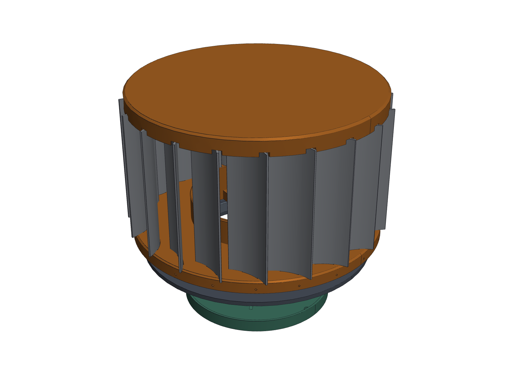

# Doghouse Whirlybird – ready-to-make CAD files

A small wind-driven roof vent (a "whirlybird") for a doghouse. It has 20 cupped aluminium blades
(scoop-shaped, overlapping like a real turbine vent) held between two 3D-printed caps, and spins on a shaft that runs in two ball bearings mounted on
the roof.



**Size:** 6.7 in tall above the roof, 10.2 in across. It prints on a Bambu Lab X1E.

---

## You don't need any CAD software to build this

Every file you need is already made. Open the folders **in number order**:

| Step | Folder | What's inside | What you do with it |
|---|---|---|---|
| **1** | [`1_TEST_PRINTS_print_these_first/`](1_TEST_PRINTS_print_these_first/) | 4 small test pieces | Print these first to find out which slot and hole sizes fit your aluminium and bearings |
| **2** | [`2_BLADES_cut_and_bend/`](2_BLADES_cut_and_bend/) | Paper template, cut files, curl die, 1:1 cup gauge | Print the PDF at 100 %, cut **one** blade, curl it in the printed die, check it on the gauge |
| **3** | [`3_PRINT_PARTS/`](3_PRINT_PARTS/) | The real parts (`.stl`) | Drag into Bambu Studio: they are already the right way up |
| **4** | [`4_DRAWINGS/`](4_DRAWINGS/) | Dimensioned drawings and pictures (PDF/PNG) | Look at how it goes together; measure against them |
| **5** | [`5_3D_MODELS_STEP/`](5_3D_MODELS_STEP/) | Full 3D models (`.step`) | Only if you want to open or change the design in Fusion 360, Onshape or FreeCAD |

Then read these two files:

* **[`PRINT_AND_ASSEMBLE.md`](PRINT_AND_ASSEMBLE.md)**: step-by-step build guide (print settings,
  cutting, bending, assembly order, roof install, troubleshooting).
* **[`BOM.csv`](BOM.csv)**: shopping and parts list (opens in Excel or Google Sheets).

## The short version

1. Print the 4 test pieces in folder 1. Note which slot width fits the aluminium snugly.
2. Cut and curl one blade with folder 2, and check it on the 1:1 cup gauge. You need 5 pieces of
   11.75 × 3.75 in aluminium for all 20 blades (4 per piece).
3. If the sizes from steps 1–2 differ from the defaults, have them updated (see "Changing a size"
   below) **before** printing the big parts.
4. Print the parts in folder 3. For the roof adapter, pick the one file that matches your
   roof's slope.
5. Assemble following `PRINT_AND_ASSEMBLE.md`, then spin-test it before it goes on the roof.

## File types, in plain words

| Ending | What it is | Open with |
|---|---|---|
| `.stl` | a 3D shape for printing | Bambu Studio (or any slicer) |
| `.pdf` | drawings and the 1:1 paper templates | any PDF viewer; print templates at **100 % / actual size** |
| `.dxf` / `.svg` | flat cut outlines for the blades | laser/CNC/vinyl cutter software, Inkscape |
| `.step` | the editable 3D model | Fusion 360, Onshape, FreeCAD |

## Changing a size

All sizes live in one file: [`whirlybird/MASTER_PARAMETERS.json`](whirlybird/MASTER_PARAMETERS.json).
Change a number there and regenerate. Everything in folders 1–5 is rebuilt and re-checked
automatically (about 4 minutes):

```bash
cd whirlybird/cad
xvfb-run -a python build_all.py
```

Or ask Claude Code in this repo: *"set the pocket width to 2.05 and rebuild."*

## Before you build: things to know

* Some sizes are **placeholders until you print the test pieces**: slot width, bearing fit, shaft
  fit, and how much the aluminium springs back after bending.
* Your roof pitch was unknown, so 5 roof adapters are provided. Flat up to 3/12 stays under the
  7.5 in limit; 4/12 and 5/12 make the unit taller than that.
* The design is **not waterproof**. It sheds most rain; an optional drip tray is included.
* A few requested sizes had to change for the design to work (for example, larger caps and an open
  centre in the lower cap so air can actually flow). These are explained in
  [`whirlybird/DESIGN_REPORT.md`](whirlybird/DESIGN_REPORT.md).

## For the technically curious

| Folder | Contents |
|---|---|
| `whirlybird/` | the design itself: parameter file, Python CAD source (`cad/`), design report, automatic check results (`reports/`) |
| `cad_workspace/` | spec template and an example part for starting new CAD projects |
| `scripts/`, `AGENTS.md`, `CLAUDE.md`, `.mcp.json` | environment setup and instructions for Claude Code |
