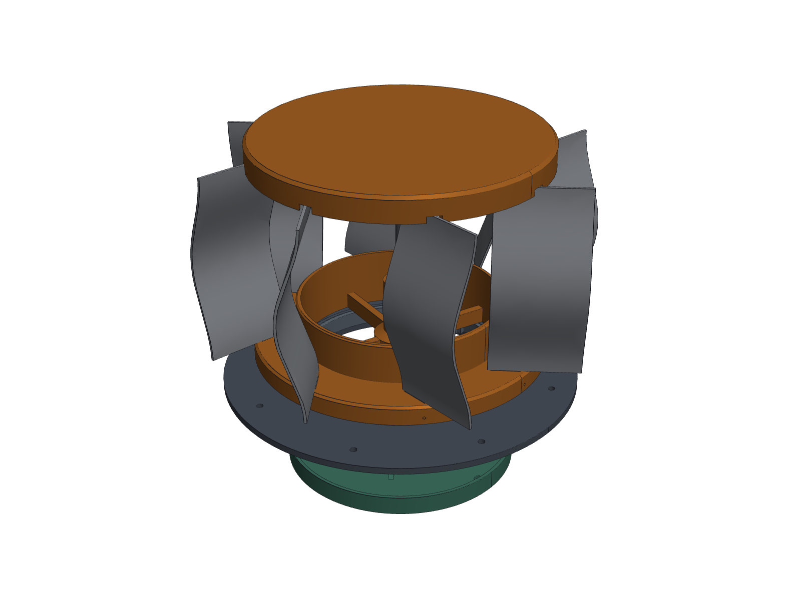

# Doghouse whirlybird – parametric CAD package (DW-V1.1)

Eight vertical, bowed 1.6 mm aluminium vanes held only by two printed caps with **blind** pockets:
- **Upper cap:** closed top, pockets open underneath.
- **Lower cap:** closed underneath every pocket, pockets open on top.

The caps are fixed to a rotating 1/4 in shaft. That shaft runs in two R4-2RS bearings carried by a
**separate stationary** tower in a roof flash adapter.

| | |
|---|---|
| Installed height | **165.2 mm / 6.51 in** (limit 190.5) |
| Rotor OD | **259.1 mm / 10.20 in** (target 266.7; see DESIGN_REPORT §2) |
| Blade-to-blade clearance | 50.5 mm |
| Rotor ↔ stationary clearance | 6.0 mm axial, 2.0 mm labyrinth |
| Design gates | **17 / 17 PASS** on the CAD; all 25 STEP files valid (agentcad); all 21 STLs watertight and manifold |



## Start here
1. `PRINT_AND_ASSEMBLE.md`: phases, slicer settings, assembly order, roof install, troubleshooting.
2. `DESIGN_REPORT.md`: decisions, **requirement conflicts that need your review**, calculations,
   assumptions, and what still needs physical validation.
3. `deliverables/pdf/fabrication_drawings.pdf`: 12 sheets of dimensioned drawings from the CAD.

## Deliverables (`deliverables/`)
| Spec item | File(s) |
|---|---|
| 1 Parameters | `../MASTER_PARAMETERS.json` (inputs + derived + unresolved) |
| 2 Assembly + native source | `step/whirlybird_complete_assembly.step`, `step/rotor_subassembly.step`, source `../cad/*.py` (build123d) |
| 3 Upper hub | `step/upper_hub_closed_top.step`, `stl/upper_hub_closed_top.stl` |
| 4 Lower hub | `step/lower_hub_closed_bottom.step`, `stl/lower_hub_closed_bottom.stl` (solid-disc alternate also exported, not recommended) |
| 5 Blade patterns | `dxf/blade_flat_pattern_single_TEST.dxf`, `dxf/blade_flat_pattern_8x.dxf`, `svg/blade_template_1to1.svg`, `pdf/blade_and_roof_templates_1to1.pdf` (1:1 blank, profile gauge, stock nest, roof template) |
| 6 Forming jig | `stl|step/blade_forming_die_lower`, `blade_forming_die_upper` |
| 7 Coupons | `stl/single_blade_socket_test_top.stl`, `stl/single_blade_socket_test_bottom.stl`, `stl/slot_clearance_coupon_1p85_1p95_2p05_2p15.stl`, `stl/bearing_and_shaft_fit_coupon.stl` |
| 8 Stationary parts | `bearing_support_stationary`, `roof_flash_adapter` (+ `_pitch_0in12` … `_5in12`), `rain_baffle_if_needed` (STEP + STL) |
| 9 Drawings | `pdf/assembly_exploded.pdf`, `pdf/assembly_section.pdf`, `pdf/rotor_vs_stationary.pdf`, `pdf/CAD_views_top_side_underside.pdf`, `pdf/fabrication_drawings.pdf`, `renders/*.png` |
| 10 BOM | `BOM.csv` |
| 11 Instructions | `../PRINT_AND_ASSEMBLE.md` |
| 12 Bambu project | not generated (no Bambu Studio here). The STLs are pre-oriented: import, assign filament, save project |
| 13 8/10/12 comparison | `pdf/comparison_8_10_12_blades.pdf`, `reports/variant_study.csv` |
| Verification | `reports/design_checks.json`, `reports/mesh_verification_log.txt`, `reports/agentcad_validation.json`, `reports/step_roundtrip.json` |
| Extras | `inlet_vent_louver` (×2), `shaft_dimple_drill_guide`, `thrust_washer_top/bottom` |

All STEP files share one origin: roof surface at the rotor axis, +Z up. STL files are re-posed for
the X1E bed.

## Regenerate after changing a parameter
```bash
cd whirlybird/cad
xvfb-run -a python build_all.py      # CAD, checks, STEP/STL/DXF/SVG, renders, PDFs, BOM (~4 min)
python validate_agentcad.py          # independent STEP validation + spec checks
```
The build exits non-zero if any design gate fails.
